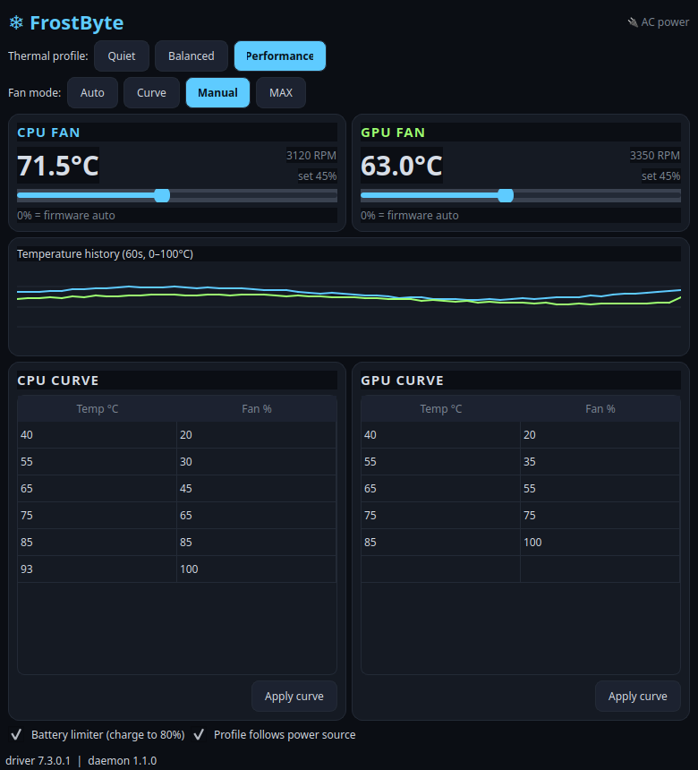

# ❄ FrostByte

[](LICENSE)
[](https://github.com/VanguardArts/frostbyte/releases)
[](https://github.com/VanguardArts/frostbyte)
[](#how-it-works)

**Open-source NitroSense/PredatorSense replacement for Linux** — fan control,
thermal profiles, fan curves and battery care for Acer Nitro & Predator
laptops. Built for KDE Plasma (Kubuntu), works anywhere with Python + Qt6.



FrostByte was born on an **Acer Nitro AN517-54** running Kubuntu, after the
existing tools proved buggy and silently lost their kernel driver on a kernel
update. FrostByte is designed so that can't happen: the driver is a clean
DKMS package that rebuilds itself on every kernel update.

## Features

- 🌡 **Live monitoring** — CPU & GPU temperatures and real fan RPMs
- 🌀 **Four fan modes** — Auto (firmware), Manual (per-fan sliders),
  **MAX** (one click / `frostctl max`), and **Curve** (your own temp→speed maps)
- 📉 **Editable fan curves** — independent CPU/GPU curves, applied by the daemon
- ⚡ **Thermal profiles** — quiet / balanced / performance, with optional
  per-power-source memory (AC vs battery)
- 🔋 **Battery limiter** — cap charge at 80% to preserve battery health
- 🛟 **Safety override** — fans are forced to 100% near critical temps and
  returned to firmware control if the daemon stops
- 🖥 **GUI + CLI + tray** — PyQt6 dashboard, `frostctl` for scripts, system tray
- 🔘 **NitroSense key support** — the dedicated **N** key toggles the FrostByte
  window, exactly like on Windows (works under X11 and Wayland, no desktop
  shortcut binding needed)
- 🔄 **Survives kernel updates** — DKMS rebuilds the driver automatically

## How it works

```
┌──────────────┐   JSON / unix socket   ┌────────────────────┐
│ frostbyte    │ ─────────────────────▶ │ frostbyte-daemon   │ (root)
│ GUI/frostctl │ ◀───────────────────── │  • curve engine    │
└──────────────┘                        │  • safety override │
                                        └─────────┬──────────┘
                                                  │ sysfs
                                        ┌─────────▼──────────┐
                                        │ acer_wmi (DKMS)    │
                                        │ acer-wmi-linuwu    │
                                        └─────────┬──────────┘
                                                  │ WMI/ACPI
                                        ┌─────────▼──────────┐
                                        │ Laptop firmware/EC │
                                        └────────────────────┘
```

The kernel driver exposes `/sys/devices/platform/acer-wmi/nitro_sense/`
(`fan_speed`, `battery_limiter`, …) and fan RPM sensors under hwmon.
Only the root daemon touches sysfs; the GUI and CLI are unprivileged
clients of its socket API.

## Install

### Kubuntu / Ubuntu / Debian — the .deb (recommended)

Download `frostbyte_<ver>_all.deb` from
[Releases](https://github.com/VanguardArts/frostbyte/releases), then:

```bash
sudo apt install ./frostbyte_*_all.deb
```

DKMS builds the driver for your kernel, the daemon and NitroSense-key
services start automatically, and everything updates cleanly with apt.

### Any distro — from source

```bash
git clone https://github.com/VanguardArts/frostbyte && cd frostbyte
sudo ./install.sh
```

Either installer will:
1. verify dependencies (`dkms`, headers, `python3-pyqt6`, …),
2. remove stale `linuwu_sense`/DAMX driver config that conflicts,
3. build & install the vendored `acer-wmi-linuwu` driver via DKMS,
4. install the daemon (systemd, auto-start), CLI, GUI and desktop entry,
5. run a smoke test.

> **DAMX users:** the installer stops & disables the DAMX daemon (both fight
> over the same hardware) but leaves DAMX's app files untouched, so you can
> go back any time: `sudo systemctl enable --now damx-daemon` after
> uninstalling FrostByte.

## Use

```bash
frostbyte            # GUI (or find "FrostByte" in the app menu)

frostctl status      # temps, RPMs, mode, profile
frostctl max         # full-speed fans  (the NitroSense "Max" button)
frostctl auto        # firmware control
frostctl fans 60 70  # manual: CPU 60%, GPU 70%
frostctl curve       # enable your custom curves
frostctl curves                     # show them
frostctl set-curve cpu "40:20,60:45,80:80,93:100"
frostctl profile performance
frostctl limiter on  # battery charge cap 80%
frostctl watch       # live status line
```

### The NitroSense key

Press the dedicated **N** key to show/hide FrostByte. A tiny root service
(`frostbyte-keyd.service`) listens for the key's scancode (0xf5, seen as
keycode 425 — or 148 where systemd's hwdb remaps it) and toggles the GUI in
your session. If your model uses a different code, discover it with:

```bash
sudo frostbyte-keyd --learn   # then press the N key
```

and set it in `/etc/frostbyte/frostbyte.conf` under `[hotkey] keycodes=`.

Logs: `journalctl -u frostbyte-daemon -f` · Config: `/etc/frostbyte/frostbyte.conf`

## Uninstall

```bash
sudo apt purge frostbyte         # if installed from the .deb
sudo ./uninstall.sh              # if installed from source
                                 # KEEP_DRIVER=1 keeps the DKMS driver
                                 # PURGE=1 also deletes /etc/frostbyte
```

## Supported hardware

Anything the driver supports — see its [supported model table](driver/acer-wmi-linuwu/README.md).
Developed and tested on **Acer Nitro AN517-54** (i7-11800H / RTX 3050 Ti).

## FAQ

**Why did my old tool stop responding to "max speed"?**
Its out-of-tree `linuwu_sense` module disappeared (typically a kernel update).
FrostByte's driver is DKMS-managed and rebuilds on every kernel update —
`dkms status` should always show it installed.

**Secure Boot?** The module is unsigned; with Secure Boot enabled you must
enroll a MOK or disable Secure Boot.

**Is it safe?** Fans are cooling hardware, so FrostByte errs toward *more*
cooling: critical temps force 100%, and stopping the daemon returns control
to the firmware. As with every project that talks to undocumented firmware
methods (see credits), **use at your own risk**.

## Credits & license

- Kernel driver: vendored [acer-wmi-linuwu](https://github.com/adityaruplaha/acer-wmi-linuwu)
  (GPL), itself merging [Linuwu-Sense](https://github.com/0x7375646F/Linuwu-Sense)
  and PXDiv's [Div-Linuwu-Sense](https://github.com/PXDiv/Div-Linuwu-Sense)
  onto the upstream kernel `acer-wmi` driver.
- Inspiration: [DAMX / Div-Acer-Manager-Max](https://github.com/PXDiv/Div-Acer-Manager-Max)
  and Acer's own NitroSense.

FrostByte is free software under the **GNU GPL v3 or later** — see
[LICENSE](LICENSE). The vendored driver keeps its own license
(see [driver/acer-wmi-linuwu](driver/acer-wmi-linuwu)).
